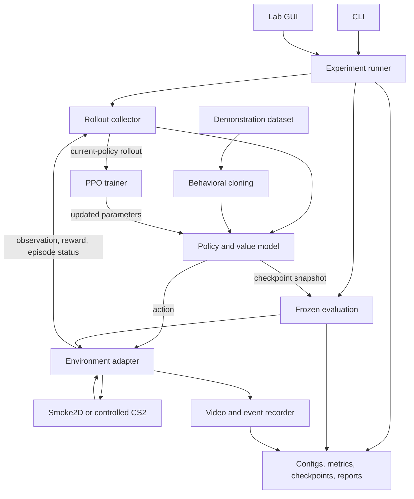

# lynxai: Foundational Project Plan

> Build a research platform that learns progressively more useful Counter-Strike 2 behaviors, makes its learning visible, and produces experiments that another person can understand and reproduce.

**Status:** foundational design; most of the system is still to be implemented. Section 2 separates existing capabilities from planned ones. New commands, schemas, directories, and numerical targets below are proposed unless explicitly marked as implemented.

**Guiding principle:** build the smallest complete experiment that answers the next important question. CS2 is the target; the 2D environment exists to verify the learning infrastructure.

## How to use this plan

Read sections 1–3 for direction, sections 4–12 when implementing a subsystem, and sections 13–14 when choosing the next task. Milestones are ordered by dependencies and have explicit acceptance criteria. Complete a milestone by linking its evidence, not merely by checking off its code.

| Topic | Where to look |
|---|---|
| Vision, scope, and existing code | [1. Vision](#1-vision-and-definition-of-success), [2. Current foundation](#2-current-foundation), [3. Decisions](#3-working-decisions-and-scope) |
| Architecture and environment integration | [4. Architecture](#4-system-architecture), [5. Contracts](#5-core-contracts), [6. CS2 integration](#6-cs2-integration-and-feasibility) |
| Agent and experiment design | [7. First tasks](#7-first-tasks-observations-actions-and-rewards), [8. Learning](#8-learning-strategy), [9. Evaluation](#9-evaluation-and-research-method) |
| Reproducibility and product experience | [10. Artifacts](#10-configuration-data-and-checkpoints), [11. CLI and GUI](#11-cli-gui-and-visual-explanations), [12. Runtime](#12-runtime-performance-and-reliability) |
| Execution and future work | [13. Milestones](#13-milestones-and-acceptance-criteria), [14. Next tasks](#14-next-implementation-tasks), [15. Research](#15-later-research-program) |
| Risks and maintenance | [16. Risks](#16-risks-and-decision-points), [17. Maintenance](#17-maintaining-this-plan-and-publishing-results), [18. References](#18-technical-references) |

## 1. Vision and definition of success

lynxai should become a personal ML research lab for learning to play CS2. It should support observing the game, selecting actions, collecting outcomes, training policies, evaluating frozen checkpoints, and explaining the results through metrics and video.

The long-term agent should develop useful perception, aiming, movement, combat, memory, and eventually objective-level behavior. The application should make it easy to create an experiment, watch it run, inspect a failure, compare checkpoints, and decide what to try next.

The project has three equally important outputs:

1. **A learning agent:** measurable progress on increasingly difficult, controlled CS2 tasks.
2. **A reliable experiment system:** repeatable scenarios, traceable datasets and checkpoints, recoverable runs, and fair comparisons.
3. **An understandable research story:** evidence showing what improved, what failed, and what each improvement cost in data, time, and compute.

A **policy** is the model that chooses actions from observations. **Reinforcement learning (RL)** improves that policy using outcomes from its own actions; **behavioral cloning (BC)** learns to imitate recorded actions. An **episode** is one attempt at a task, from reset to an ending condition. These concepts stay the same as the project moves from the 2D simulation to CS2.

### First useful release

The first useful release completes this workflow on one narrow CS2 task:

1. Select a versioned scenario and experiment configuration.
2. Run a baseline and train a small policy within a fixed budget.
3. Save a checkpoint, reload it, and evaluate it without updating weights.
4. Compare it with the baseline on held-out scenario variations.
5. Open a report with raw results, learning curves, and representative clips.

The initial task is stationary target acquisition: aim and fire at a target whose position varies within a controlled range. Movement and a returning-fire opponent follow after this loop works. Success on this task establishes a component of CS2 play, not full match competence.

### Research success

An improvement claim needs a declared metric, repeated training runs, a fixed evaluation procedure, and an explanation of uncertainty. A negative result can still be a successful experiment if it is reproducible and informs the next decision.

The core comparison is **PPO from scratch versus behavioral cloning versus behavioral cloning followed by PPO**, under the same observation, action, and scenario definitions. Demonstration collection and pretraining costs must be visible. Prediction and memory are later experiments, not assumed improvements.

## 2. Current foundation

This inventory reflects the repository at commit `28b0b22` (`smoke2d`). Update it as implementation advances.

| Area | Implemented now | Remaining work |
|---|---|---|
| Package | `src/lynxai`, `python -m lynxai`, and the `lynxai` entry point | Development documentation, pinned dependency workflow, CI |
| Diagnostics | `lynxai doctor` checks Python, PyTorch, CUDA availability, writable directories, and baseline config loading | Separate core, training, and CS2 host checks |
| Configuration | YAML loaded into dataclasses in `utils/config.py` | Schema versions, value validation, unknown-key rejection, resolved config snapshots |
| Paths | Runtime directory helpers in `utils/paths.py` | Configurable artifact root and installed-package behavior |
| Simulation | `environments/smoke2d.py`: five numeric observations, four actions, goal/fall/timeout outcomes | Gymnasium compatibility, package relocation, trainer integration |
| Tests | Six tests covering simulation behavior and package namespace | Contract, training, checkpoint, evaluation, and integration tests |
| ML dependencies | PyTorch and Gymnasium declared; Stable-Baselines3 available through the `ppo` extra | A policy, training command, rollout collection, and evaluation runner |
| CS2 and application | No CS2 adapter or functioning GUI | Integration feasibility, control loop, demonstrations, recording, UI |

During cloud setup, the six existing tests, CLI diagnostics, dependency checks, and source/wheel builds passed with CPU PyTorch. This validates the existing foundation only. No learned policy or CS2 interaction has been demonstrated.

Two existing details need deliberate migration:

- The simulation currently lives outside `src/lynxai`, so configured package discovery does not include it in the installed distribution.
- Its API returns `obs` from reset and a four-item tuple from step. The target Gymnasium API returns `(obs, info)` and distinguishes termination from truncation.

The existing `configs/baseline.yaml` is a scaffold. Its observation, action, and reward settings do not define an implemented CS2 experiment and should not silently become the research baseline.

## 3. Working decisions and scope

These defaults make development actionable. Change them when an experiment or integration constraint supplies a reason, and record the decision.

| Decision | Initial choice | Reason |
|---|---|---|
| Language and ML | Python and PyTorch | Match the current code and research ecosystem |
| Environment API | Gymnasium | Explicit spaces, episode semantics, and established tooling |
| RL implementation | Stable-Baselines3 PPO | Establish a trusted baseline before implementing an algorithm |
| Smoke policy | Small multilayer perceptron (MLP) on the existing numeric observations | Verify training without introducing a rendering project |
| CS2 policy | Small convolutional neural network (CNN), policy head, and value head | A manageable first visual policy |
| First combat actions | Bounded discrete aiming increments plus fire | Aiming is necessary to solve variable target positions |
| First runtime | One game host, one environment, synchronous collection and updates | Minimize synchronization and policy-version ambiguity |
| Experiment records | Local JSON/JSONL records and TensorBoard when training begins | Usable offline, with exportable source data |
| Interface | CLI first; PySide6 desktop lab after the backend works | Keep operations testable while preserving the visual product goal |
| Storage | Local artifacts with explicit manifests and retention limits | Avoid an early database or hosted-service dependency |

### Boundaries

Training uses local, private, or otherwise authorized controlled CS2 scenarios. Public matchmaking and anti-cheat evasion are outside the project. Human demonstrations, demos, and spectator material are research inputs where collection and use are permitted.

The first release does not require a full match, multiple agents, grenades, economy management, a world model, a large transformer, distributed training, or a custom PPO implementation. These remain possible extensions after the basic loop produces credible results.

The 2D environment remains a small regression fixture. Add only what is needed to validate contracts, training, checkpointing, and evaluation. Its model weights are not expected to transfer to CS2; its infrastructure should.

### Development machine versus game host

The cloud environment supports package development, tests, the 2D task, and processing recorded data. Running CS2 additionally requires a suitable game installation, graphics/display support, a supported capture and input path, and sufficient compute. None of those capabilities is established by a passing cloud `doctor` command.

Select and document the actual game host OS, GPU, display configuration, and integration methods during the CS2 feasibility milestone. Keep platform-specific code inside the CS2 adapter. A second machine is an optimization to investigate after profiling the single-host system.

## 4. System architecture

Keep the policy independent of game-specific capture, input, and reset mechanisms. Use the same experiment operations from both the CLI and GUI.



Collection, updates, and evaluation are coordinated phases, not concurrent owners of one environment. Recording can run asynchronously through bounded queues.

| Component | Responsibility |
|---|---|
| Experiment runner | Resolve config, create run, enforce lifecycle, dispatch collection/training/evaluation, handle stop and failure |
| Environment adapter | Reset, expose spaces, apply actions, produce observations and rewards, report episode status |
| CS2 backend | Capture frames, control inputs, receive events, configure scenarios, verify resets |
| Observation pipeline | Crop, resize, normalize, stack history, validate freshness and shape |
| Policy | Map observations and optional recurrent state to an action distribution and value estimate |
| Trainer | Optimize the selected objective using valid data and record update diagnostics |
| Evaluator | Run frozen policies against versioned suites and compute task metrics |
| Artifact manager | Write manifests, metrics, checkpoints, dataset references, and reports |
| Recorder | Align video with events and policy versions; preserve representative failures and highlights |

Start with ordinary Python modules and a local worker process. Introduce service boundaries only when isolation or measured resource contention requires them.

### Target code organization

Create modules as their milestone needs them; this is not a request to generate empty scaffolding.

```text
src/lynxai/
  cli.py                  # existing entry point; commands call the runner
  app/                    # GUI and presentation
  environments/           # Gymnasium environments, including Smoke2D
    cs2/                  # capture, input, events, scenarios, reset
  agents/                 # model definitions and inference
  training/               # PPO integration and behavioral cloning
  evaluation/             # suites, baselines, metrics, comparisons
  experiments/            # run lifecycle and configuration resolution
  data/                   # demonstration schemas and loaders
  recording/              # video, event alignment, clips
  artifacts/              # manifests, checkpoints, reports
  utils/                  # focused shared helpers
configs/                  # versioned experiment definitions
scenarios/                # scenario specifications and split manifests
tests/                    # unit, integration, and system tests
docs/                    # setup, integration evidence, decisions, experiments
```

## 5. Core contracts

### Environment contract

Use a `gymnasium.Env` implementation or a thin adapter with the following public behavior:

```python
obs, info = env.reset(seed=seed, options={"scenario_id": scenario_id})
obs, reward, terminated, truncated, info = env.step(action)
env.close()
```

- `observation_space` and `action_space` describe exact shapes, dtypes, bounds, and semantics.
- `reset` returns only after a valid initial state and observation are available.
- `terminated` identifies a task terminal state, such as success or death.
- `truncated` identifies an external episode cutoff, such as a time limit. Whether a deadline is intrinsic to a task must be defined in that task's specification.
- The trainer must preserve terminal observations and use the selected framework's correct time-limit bootstrapping behavior. Do not collapse both flags into a single training `done` signal.
- Capture failures, broken resets, and lost synchronization are infrastructure errors. Release inputs and invalidate affected data; do not disguise an invalid observation as a normal timeout transition.
- `close`, stop, and failure handling release held inputs and recording resources. Repeated cleanup should be safe.

Use the environment checker supplied by the chosen training library, plus behavioral tests. Verify the library's vector-environment wrapper semantics separately; its interface may differ from raw Gymnasium.

### Transition and event records

Each collected transition needs enough context to debug causality:

| Field | Meaning |
|---|---|
| Identity | Run, episode, scenario version, step index, policy version |
| Observation | Frame/state reference, capture timestamp, preprocessing version |
| Action | Requested action, applied action, dispatch time, duration, any clipping |
| Outcome | Next observation, reward components, terminal/truncation reason |
| Timing | Observation age, step duration, dropped-frame count, event alignment status |

Use monotonic timestamps for ordering and duration within a process/host, and UTC timestamps for artifact provenance. If multiple hosts are later introduced, define clock alignment and uncertainty explicitly.

Events carry an episode identity, type, source, timestamp, and deduplication identity where available. Reward logic must handle duplicated or delayed messages and counter resets. Do not count one kill or damage event on multiple steps.

### Information boundaries

Separate three kinds of information:

1. **Policy inputs:** observations the agent is allowed to use at decision time.
2. **Training signals:** rewards or auxiliary labels that may come from instrumented scenario state.
3. **Evaluation and debugging data:** ground truth used to score or inspect behavior.

A vision-only policy must not accidentally receive enemy coordinates through `info`, reward features, or a training wrapper. Structured-state and hybrid agents are separate experiment conditions with their available information stated explicitly. Do not assume CS2 exposes every desired state field.

### Run lifecycle

Use explicit states: `created`, `initializing`, `collecting`, `updating`, `evaluating`, `paused`, `completed`, `stopped`, and `failed`.

Training/evaluation switches take effect at a safe boundary. Evaluation uses a checkpoint snapshot and fixed preprocessing statistics. Pausing releases inputs; resuming either verifies the current state or begins a new episode. A failed run retains its last valid checkpoint and a machine-readable failure reason.

## 6. CS2 integration and feasibility

The largest early uncertainty is whether the chosen game host can reliably provide **capture, input, outcomes, and resets**. Prove all four before committing to a large training run.

### Integration investigation

Evaluate supported practice/workshop/server tooling, game-state feeds where available, and host capture/input facilities. Treat documentation as a starting point: record the exact CS2 build, host, and successful probe for each capability.

| Capability | Required proof |
|---|---|
| Frame capture | Correct game window, known resolution and color format, fresh frames during play |
| Input | Reproducible bounded camera movement, fire press/release, and later movement combinations |
| Scenario setup | Target/player placement and task conditions can be established and verified |
| Outcome detection | Success, death when relevant, timeout, and reset events can be distinguished |
| Reset | Repeatedly returns to the specified starting conditions without manual correction |
| Timing | Measured frame age, control interval, event delay, and reset duration |
| Cleanup | Stop, window loss, exception, and worker failure leave controls released |

A game-state feed is not automatically a control or reset API. Demo playback is not automatically an action-labeled dataset. A custom map is not automatically a deterministic simulator. Record these capabilities separately.

Create an integration note under `docs/` with the chosen mechanisms, reproducible setup steps, observed limitations, fallback options, and a capability matrix. Do not make an undocumented memory reader or invasive game modification a hidden prerequisite.

### Minimal live probe

1. Open one controlled scenario and capture a labeled sample frame.
2. Apply a bounded aim action; measure the resulting camera displacement.
3. Press and release fire; verify the input and its observable effect.
4. Trigger one known outcome and confirm it is recorded once.
5. Reset and verify player state, target state, and observation freshness.
6. Repeat the cycle and inject failures such as focus loss and interrupted capture.

Manual resets are acceptable while exploring integration, but they do not satisfy the automated-training gate. If reliable reset or outcomes are unavailable, continue reusable ML work in Smoke2D and record CS2 training as blocked. A substitute sandbox may answer an infrastructure question but does not count as CS2 validation.

### Real-time stepping

Smoke2D advances when `step` is called. CS2 may continue running while Python captures a frame, computes an action, or updates a model. The adapter must expose that difference.

For each control interval, obtain a fresh observation, compute and apply the action, maintain its defined duration, then align the next observation and intervening outcomes. Log actual duration and frame age. Do not silently reuse stale frames or accumulate an unbounded action queue.

Begin with synchronous PPO collection and updates. If the game cannot be paused during optimization, release inputs, leave the unrecorded interval out of the rollout, and establish a verified new episode before collecting again. Plan collection/update boundaries so live episodes do not silently continue through optimizer delays. Keep valid rollout cutoffs distinct from task termination.

If collection deliberately ends an unfinished episode before an update, expose that cutoff as a truncation with a valid final observation and correct bootstrapping. Reset the collector's observation/history and episode bookkeeping before the next rollout. Do not reset the game behind the trainer's back. Record these operational cutoffs separately from task timeouts in evaluation and metrics.

Asynchronous actors and learners require policy-version tracking and an algorithm-compatible treatment of stale data; they are later work.

## 7. First tasks, observations, actions, and rewards

### Task progression

Each task has its own scenario version, observation/action definitions, reward specification, episode endings, and evaluation suite.

| Task | Agent controls | Primary outcome | Purpose |
|---|---|---|---|
| Smoke2D | Left, right, jump, no-op | Goal reached before fall or timeout | Verify the ML pipeline |
| CS2 target acquisition | Camera yaw/pitch and fire; player position fixed | Target eliminated within the episode limit | Establish visual aiming and firing |
| CS2 moving target | Same actions; controlled target motion | Success rate by speed/direction | Test tracking and temporal information |
| CS2 simple duel | Aim, fire, and bounded movement; one opponent | Duel win rate | Introduce movement, damage, and death |
| CS2 scenario family | Wider spawn/cover/distance variation | Held-out scenario performance | Test generalization |

Do not add all mechanics at once. Every task should be solvable by a human and at least one simple reference controller before training begins. A controller using privileged state is useful for diagnosing the environment, but must be labeled as such in comparisons.

### Initial visual observation

Start with a single grayscale gameplay frame resized to **160 × 90**, preserving its aspect ratio. Inspect target visibility at all planned distances before accepting this default. Move to color or a larger image only when visibility or an experiment justifies the cost.

Specify and version:

- Capture region, source resolution, resizing method, color conversion, and HUD inclusion.
- Tensor shape and layout; initially `(1, 90, 160)` with `uint8` pixels in `[0, 255]` at the environment boundary.
- Exactly one normalization step in the model/wrapper pipeline.
- History length and sampling interval when frame stacking is introduced.
- Reset behavior for frame history and handling of stale or missing frames.

The CNN must accept the declared dimensions; verify the complete wrapper-to-policy path with a real batch. Save sample processed frames with each configuration so an incorrect crop or normalization is visible.

Use a single frame for the first stationary task. Compare it with four-frame history when motion becomes relevant. Recurrent state comes later and must be reset at episode boundaries.

### Initial action space

For target acquisition, use a factorized discrete action space such as `MultiDiscrete([3, 3, 2])`:

| Factor | Values |
|---|---|
| Yaw increment | Left, zero, right |
| Pitch increment | Down, zero, up |
| Fire state | Released, held |

This allows aiming and firing together. A single categorical choice among `W`, `A`, `S`, `D`, and fire would prevent simultaneous actions and would not provide general aiming.

The input adapter maps increments to calibrated mouse displacement on the chosen host. Record sensitivity, relevant acceleration settings, camera configuration, maximum displacement, and control interval. The exact increment sizes are selected by the feasibility probe, then fixed for the baseline.

Start with a nominal **10 decisions per second** if capture and input can sustain it. This is a measured operating choice, not a required game frame rate. Fire is a held button state for the interval; a neutral action releases it. Bound camera movement and implement release-all independently of policy inference.

For movement tasks, add strafe and forward/back factors with neutral values. Keep impossible opposing directions out of the mapping. Add jumping, reload, weapon changes, secondary fire, and objective interactions only when the scenario requires them. Continuous aim is a later comparison with its own policy distribution and checkpoint compatibility rules.

### Reward design

Use task outcomes as the initial reward and log each component separately:

| Task | Initial reward |
|---|---|
| Smoke2D | Preserve the existing goal/fall/time-limit behavior for the first baseline; document any semantic change during Gymnasium migration |
| Target acquisition | `+1` for verified target elimination; `0` otherwise |
| Simple duel | `+1` for elimination, `-1` for death; declare simultaneous-outcome handling |

Use a fixed episode cap so doing nothing does not create an unlimited episode. A valid time-limit cutoff still counts as failure for the success-rate metric, even when the learning algorithm bootstraps its value estimate.

Sparse reward may make exploration slow. First verify that scripted/human actions can earn it. Then compare one change at a time: demonstration initialization, easier target placement, or a bounded shaping term such as verified incremental damage. Keep the sparse baseline for reference.

Avoid unconditional survival rewards initially: they can reward inactivity. Avoid repeated rewards from cumulative event counters. Distance-to-target or aim-error shaping requires a trustworthy signal and belongs to a separately labeled experiment. Potential-based shaping is an option when its state, terminal handling, and discount assumptions are satisfied.

**Reward is an optimization signal, not the final score.** Report success, time to success, accuracy where measurable, and deaths independently of shaped return. Changing reward weights must not silently change the meaning of the evaluation suite.

## 8. Learning strategy

### Establish PPO on the smoke task

**Proximal Policy Optimization (PPO)** alternates between collecting a batch of interactions and making bounded updates to the policy. Its value model estimates future return to help the policy learn. A **rollout** is the collected sequence used for an update; PPO is **on-policy**, meaning it relies on data collected with the relevant current policy rather than an unrestricted archive of past experience.

Use the existing Stable-Baselines3 extra and a small MLP policy. Keep the library's rollout buffer and optimizer behavior intact initially. Record hyperparameters explicitly instead of relying on defaults that can change across versions.

A useful first baseline is the library's standard PPO configuration with only the environment, policy, seed, budget, and logging path selected. Verify rollout size, batch-size compatibility, observation scaling, and CPU performance before tuning.

Inspect episode outcomes, value estimates, policy entropy, approximate KL divergence, clipping fraction, and update counts. A completed run is not proof of learning: compare frozen evaluation against random and scripted policies.

### Visual PPO baseline

After CS2 integration passes its gate, use a small CNN actor-critic compatible with the chosen action space. Record parameter count, inference latency, optimizer settings, discount factor, rollout length, batch size, update epochs, and entropy/value coefficients.

Use PPO on newly collected experience from the current policy. Archived rollouts and arbitrary human demonstrations are not interchangeable with on-policy PPO data. Keep demonstrations in a separate behavioral-cloning stage unless an explicit, tested algorithm introduces them differently.

Start with a short, budgeted PPO-from-scratch pilot. If it rarely receives reward, diagnose the environment and exploration before increasing the model or running overnight. The first major comparison should include demonstration initialization early enough to avoid spending the entire project on random exploration.

### Demonstrations and behavioral cloning

Record the human's observation and the actual input applied during the following action interval. A useful dataset includes:

- Session, episode, task, scenario, and source identities.
- Frames or frame references, capture timestamps, and input timestamps.
- Button states, mouse displacement, mapped policy actions, and interval duration.
- Capture/input calibration, game build, preprocessing version, and action schema.
- Outcome events, intervention markers, data-quality flags, and collection permissions/provenance.

Inspect alignment visually before scaling collection. Quantizing human mouse motion into the initial action bins loses information; measure clipping and quantization error and keep the raw inputs. Match the collection task and control rate to the policy being trained.

Split by complete sessions and scenario groups, not adjacent frames. Keep validation and final-test sessions out of training. Log action imbalance and evaluate each action factor; high no-op accuracy is not enough.

Train by maximizing the probability of demonstrated actions. For factorized discrete actions, use the appropriate categorical losses for each factor and record any weighting. Evaluate the resulting policy in the environment because supervised accuracy alone cannot measure recovery from its own mistakes.

Initialize PPO with the compatible cloned policy. Define which encoder and policy parameters transfer, how the value head is initialized, and whether optimizer state is reset. Record the parent checkpoint. Compare BC alone with BC plus PPO to check whether RL improves or degrades behavior.

### Spectator and replay data

Keep spectator/replay observations in a separate dataset class. Without reliable aligned actions, they cannot be treated as ordinary behavioral-cloning examples. They may support representation learning, event annotation, or opponent prediction with suitable labels.

If actions are inferred, record that they are inferred and measure their quality. Never merge them silently with directly recorded human controls. Spectating after death ends the active agent episode; it is a separate collection mode.

### What to postpone

Implementing PPO from scratch is a later educational experiment against the established baseline. New algorithms, recurrent policies, large models, and auxiliary losses should each answer a diagnosed limitation. Preserve a simple reference agent throughout development.

## 9. Evaluation and research method

Evaluation is part of the first training milestone, not a final polish stage.

### Dataset and scenario splits

Maintain versioned manifests for:

| Split | Use |
|---|---|
| Training | Gradient updates, exploration, demonstration training, curriculum sampling |
| Validation | Hyperparameters, checkpoint selection, and development diagnostics |
| Final test | A frozen comparison after choices and budgets are fixed |

Separate meaningful scenario factors where possible: target positions, movement patterns, map regions, recording sessions, and later opponent styles. Random frame splits do not establish generalization. If final-test results guide another design change, treat that suite as development data and create a new untouched test split for the next claim.

### Baselines and fair comparisons

Keep at least a no-op policy, random valid actions, and a simple scripted controller. Label the information each controller uses. Add BC, PPO, and BC+PPO under identical task definitions.

For the first substantive study:

- Use at least three independent training seeds; treat this as an initial evidence floor, not a guarantee of statistical power.
- Start with 100 evaluation episodes per policy per training seed, balanced across the declared scenario groups. Increase this when uncertainty remains too large for the decision.
- Use the same scenario list for each condition, randomize/interleave execution order when practical, and record environmental drift.
- Fix the evaluation action rule: deterministic selection or a declared stochastic sampling procedure. Disable optimizer updates and freeze normalization statistics.
- Select checkpoints using validation only. Choose the primary selection metric and tie-break rule before the run.
- Compare both equal interaction budgets and wall-clock/data costs. BC+PPO includes demonstration collection and pretraining; it is not a free warm start.

Report per-seed results and aggregate uncertainty. Resampling or intervals must respect shared training seeds and scenario/session clusters; hundreds of correlated frames are not hundreds of independent experiments. With few training seeds, make the limits of the evidence explicit.

### Metrics

| Category | Initial measurements |
|---|---|
| Task | Success rate, timeout rate, deaths, time to success, accuracy when shot/hit events are reliable |
| Learning | Return and reward components, environment interactions, updates, entropy, value diagnostics, KL/clipping |
| Generalization | Performance by held-out position, distance, motion, and scenario family |
| Efficiency | Valid interactions per second, wall-clock time to a declared score, reset/update time, compute and storage use |
| Reliability | Invalid episodes, reset failures, stale frames, missed control deadlines, crashes and recovery |
| Imitation | Per-factor validation loss/accuracy and closed-loop task success |

Report time to success together with the success rate; a policy that succeeds only on easy cases can have misleadingly fast successful episodes. Define every denominator. If shot counts are unavailable, omit accuracy rather than inventing a proxy with the same name.

Infrastructure failures are reported separately from valid gameplay failures. Record all attempts and any replacement evaluations; do not silently drop bad episodes to raise the score.

### Experiment record

Before a substantive run, write a short experiment card:

1. Question and hypothesis.
2. One primary change and the reference condition.
3. Task, observation, action, reward, and dataset versions.
4. Interaction, wall-clock, compute, and storage budgets.
5. Seeds, splits, checkpoint selection rule, and primary metric.
6. Success criterion, stop conditions, and expected artifacts.

Afterward, add results, uncertainty, representative failures, and the next decision. Report negative outcomes and all planned seeds, including failed runs.

### Software validation

Keep fast tests independent of CS2 and separate them from host integration tests:

- Unit tests: reward event accounting, config validation, action mapping, preprocessing, and terminal semantics.
- Contract tests: spaces, reset determinism where supported, valid actions, wrapper behavior, and cleanup.
- Training smoke test: a short run performs real updates and produces loadable artifacts. Statistical learning thresholds belong in a longer, controlled test rather than a fragile unit test.
- Checkpoint tests: loading preserves predictions and declared state; incompatible schemas fail clearly.
- Evaluation tests: policy parameters and normalization statistics remain unchanged.
- CS2 host tests: live capture, input release, verified resets, event alignment, and failure recovery.

CI should install the package, run fast tests, and build the distribution. Exercise an installed wheel outside the checkout to catch missing modules/resources. Mark CS2 tests as requiring the game host; a skipped live test is not a pass.

## 10. Configuration, data, and checkpoints

### Configuration rules

Use versioned YAML schemas with explicit validation. Reject unknown fields, invalid ranges, incompatible spaces, and conflicting settings before starting the game or training.

Resolution order should be documented: defaults, experiment YAML, then explicit CLI overrides. Write the fully resolved configuration into the run directory and compute its hash. Record non-secret host settings separately. Credentials and machine-specific secrets do not belong in experiment artifacts.

The following is a proposed configuration shape, not something the current loader accepts:

```yaml
schema_version: 1
experiment:
  name: cs2_target_ppo
  seed: 1337
  artifact_root: ./artifacts

environment:
  id: cs2_target_v1
  scenario_manifest: scenarios/target_v1/train.json
  control_hz: 10
  max_episode_seconds: 10

observation:
  schema: grayscale_single_v1
  width: 160
  height: 90
  history_length: 1

action:
  schema: aim_fire_discrete_v1
  calibration: configs/hosts/local_aim.yaml

reward:
  schema: target_sparse_v1
  elimination: 1.0

training:
  algorithm: sb3_ppo
  hyperparameters: configs/algorithms/ppo_v1.yaml
  budget:
    environment_steps: 100000
    wall_clock_hours: 4

evaluation:
  validation_manifest: scenarios/target_v1/validation.json
  episodes: 100
  action_selection: deterministic
  selection_metric: success_rate
```

Budgets and episode limits above are starting examples to revise after measuring the host. Stop when either budget is exhausted. Store resolved hyperparameters and calibration content or immutable references, not just mutable filenames.

### Artifact layout

Use one configurable artifact root, independent of the source checkout. The current scattered runtime directories can migrate when the artifact manager is introduced.

```text
artifacts/
  datasets/<dataset_id>/
    manifest.json
    sessions/
    splits/
  runs/<run_id>/
    manifest.json
    config.resolved.yaml
    metrics.jsonl
    events.jsonl
    checkpoints/<checkpoint_id>/
    evaluations/<evaluation_id>/
    clips/
    report/
```

A run ID is unique and immutable; its display name can be descriptive. Manifests include the code commit and dirty-worktree status, relevant patch when needed, dependency versions/lock hash, host hardware, game build, scenario version, schema versions, seeds, and parent run/checkpoint.

Keep raw datasets immutable. Derived datasets reference their source and preprocessing version. Track small configurations and manifests in Git; store large videos, trajectories, and model files outside source control. Add ignore rules and a backup/retention policy as part of that implementation.

### Checkpoint contract

A checkpoint must contain or reference:

- Policy/value parameters and model architecture.
- Optimizer, scheduler, and mixed-precision state when used.
- Observation normalization and wrapper state needed for inference.
- Training counters, current schedule progress, RNG state, and seed configuration.
- Resolved config and observation/action/reward schema versions.
- Code/dependency versions, game/scenario metadata, and parent checkpoint.
- Validation results, if available, and artifact checksums.

Use the framework's supported serialization plus explicit metadata for state it does not preserve. Write checkpoints atomically, verify loadability, and update `latest`/`best` references only after a successful write. `Best` means best by the predeclared validation metric, never best on the final test set.

Distinguish three operations:

| Operation | Promise |
|---|---|
| Inference load | Restore a compatible policy and preprocessing for frozen play |
| Training resume | Restore learning state and continue from a verified episode boundary |
| Exact replay | Reproduce a trajectory only when the environment and all relevant state support it |

The initial resume guarantee is a completed PPO update followed by a fresh episode. Mid-rollout recovery and exact live-CS2 trajectory restoration are not promised. Record discarded partial work after a crash. Branching from an older checkpoint creates a new run with lineage; it does not overwrite history.

### Comparing checkpoints over time

Run saved checkpoints against the same versioned scenario suite and show scores plus matched clips. Use repeated trials when CS2 is nondeterministic. Label this as comparison under matched conditions, not exact restoration of a historical game state.

## 11. CLI, GUI, and visual explanations

### CLI as the operational interface

Only `lynxai doctor` is implemented today. Add commands when their backend capability exists:

| Planned command | Purpose |
|---|---|
| `lynxai doctor --profile core\|training\|cs2` | Check prerequisites for a specific workflow |
| `lynxai smoke-test` | Run the bounded simulation/train/save/load/evaluate workflow |
| `lynxai probe-cs2 --config HOST_CONFIG` | Verify live host capabilities and write a probe report |
| `lynxai train --config EXPERIMENT_CONFIG` | Start a traceable training run |
| `lynxai train --resume CHECKPOINT` | Continue compatible training in a new run with lineage |
| `lynxai evaluate --checkpoint CHECKPOINT --suite SUITE` | Run frozen evaluation |
| `lynxai record-demo --config COLLECTION_CONFIG` | Record aligned human demonstrations |
| `lynxai inspect-run RUN_ID` | Summarize status, provenance, metrics, and failures |
| `lynxai compare RUN_A RUN_B` | Compare compatible evaluation results |
| `lynxai report RUN_ID` | Produce a report from recorded artifacts |
| `lynxai gui` | Open the lab application |

Commands should provide actionable errors and meaningful exit codes. Print the run ID and artifact path when work starts. A diagnostic report must distinguish required failures, optional capabilities, and checks not performed.

### Lab interface

The intended experience is: **create experiment → run → inspect → compare → improve**.

Build the interface in two stages:

1. **Monitor:** live view, processed observation, run state, task outcomes, action factors, reward components, timings, logs, and stop/pause controls.
2. **Research workspace:** experiment editor, training/validation curves, checkpoint browser, comparisons, demonstration browser, highlights, and report export.

The GUI calls the same runner as the CLI. Training and capture run outside the GUI thread. Closing the window follows an explicit choice to stop the worker or leave an intentionally detached run; it must not silently orphan controls.

Keep training, demonstration recording, and frozen evaluation visually distinct. Requesting a mode switch finishes or cancels the current phase according to the runner's lifecycle. Show the active checkpoint/policy version and any invalid data or host failure.

Action probabilities and entropy help explain policy behavior, but are not calibrated confidence estimates. For factorized actions, show separate distributions for yaw, pitch, fire, and later movement rather than a misleading single list of mutually exclusive keys.

### Recording and highlights

Begin with short evaluation recordings and clips around failures. Add a rolling buffer after the live loop works. Configure pre-event/post-event duration, encoding rate, storage cap, and duplicate-event merging.

Each clip records run, episode, scenario, policy/checkpoint version, timestamps, trigger, and associated metrics. Keep both interesting successes and representative failures. A highlight reel supplements the evaluation report; it does not replace it.

Encoding and UI refresh must not block the action loop. Drop optional preview frames before allowing recording backlog to corrupt observations or actions. Track dropped frames and preserve synchronization metadata.

## 12. Runtime, performance, and reliability

### Measure the whole loop

Record capture, preprocessing, inference, input dispatch, observation age, total control-loop time, reset time, and optimizer time. Report median and tail latency, especially p95/p99, plus missed deadlines. Game rendering rate, policy decision rate, and valid training transitions per second are different measurements.

Estimate the real experiment budget before launching:

```text
collection time ≈ required valid transitions / measured valid transitions per second
wall-clock time ≈ collection + resets + updates + evaluation + expected recovery
```

At an ideal 10 transitions per second, one million transitions already needs about 27.8 hours of collection before overhead. Measure throughput on the actual game host; a fast simulator does not predict CS2 training time.

Store image rollouts efficiently. At 160 × 90 grayscale, 2,048 observations occupy about 28 MiB as raw bytes, or about 112 MiB with four stored frames per observation, before tensors, next observations, and other rollout fields. Float32 storage multiplies pixel memory by four. Estimate dataset and video size separately before collecting overnight.

Profile CPU and GPU inference rather than assuming the GPU helps a small single-observation policy. Keep headroom for game rendering. Prefer a bounded queue and fresh observations over higher nominal throughput with stale inputs.

### Long-run behavior

Before unattended training, implement and test:

- Input release on stop, lost focus, stalled worker, and exception.
- Capture/event freshness checks and reset deadlines.
- NaN/invalid-reward detection, disk-space limits, and bounded recording queues.
- Periodic durable metrics and checkpoints at recoverable boundaries.
- A finite retry policy for known recoverable host errors, with every retry logged.
- A final status record describing completion, user stop, budget exhaustion, or failure.

Learning stagnation is different from infrastructure failure. A plateau should trigger an analysis flag or a declared early-stop rule, not an endless automatic restart. Do not silently change hyperparameters mid-run to force progress.

The minimum long-run rehearsal should deliberately stop and restart training from a checkpoint and confirm compatible predictions, restored counters, new run lineage, and clean input state. Resume learning only after the environment is ready.

## 13. Milestones and acceptance criteria

The dependency path is **M0 → {M1 and M2} → M3 → M4 → M5**. M1 establishes the learning pipeline and M2 establishes the game host; they can proceed in parallel once the core contracts are defined. CS2 training depends on both being complete. M6 research branches follow evidence from the earlier stages.

Each milestone should end with a short completion note linking code, configs, commands, test results, and artifacts. Numerical thresholds below are initial engineering targets. If a pilot shows that a target is inappropriate, record the reason and revise it before the qualifying run; do not lower a threshold after seeing the result simply to declare success.

### M0 — Make the existing foundation installable and explicit

**Goal:** a new developer can install the project and understand exactly what currently works.

Work:

- Move or adapt Smoke2D into the installed `lynxai` namespace and update imports deliberately.
- Adopt the Gymnasium contract, declared spaces, and termination/truncation semantics.
- Add validated task-specific configuration and configurable artifact paths.
- Choose a supported Python/dependency pinning workflow, document CPU and game-host setup, and add fast CI checks.
- Keep core imports usable without optional GUI or CS2 host dependencies.

**Acceptance:** existing behavior remains covered; environment checks and new contract tests pass; a wheel installed outside the checkout can import and run Smoke2D; diagnostics identify which workflow is ready. No live CS2 result is required.

### M1 — Complete the smallest learning experiment

**Goal:** train, save, reload, and evaluate a learned Smoke2D policy.

Work:

- Add random and scripted baselines, a small PPO/MLP training path, and the run artifact structure.
- Record configs, seeds, metrics, update counts, and package/code versions.
- Save/load a policy and run frozen evaluation with fixed validation seeds.
- Implement controlled stop and resume at a completed-update boundary.

**Acceptance:** the scripted policy demonstrates task solvability; PPO achieves at least 90% goal success on 100 held-out reset seeds for each of three training seeds within a declared budget; random baseline results are reported. Reloaded deterministic predictions match on fixed observations, evaluation leaves parameters unchanged, and resume produces a traceable new run.

If the learning target fails, diagnose the task/API/reward/trainer before adding new simulation features. Once this gate passes, stop expanding the 2D game. A GUI is not a prerequisite.

### M2 — Prove the controlled CS2 loop

**Goal:** establish that the selected game host can support automated experiments.

Work:

- Select the host and document tested capture, input, event, and scenario/reset mechanisms.
- Implement the first target-acquisition scenario and a live probe command.
- Calibrate camera increments and control rate; measure event delay and reset time.
- Record short traces and test stop, focus loss, stale capture, and failed reset behavior.

**Acceptance:** a scripted/human probe produces verified outcomes; 100 attempted reset-and-episode cycles achieve at least 99% valid completion without manual correction; every failure is reported; event counts match the probe evidence; held inputs are released in all exercised failure cases. Publish latency distributions and demonstrate that the chosen control rate meets its declared freshness/deadline limits.

**Decision gate:** if outcomes or resets cannot be made reliable, document the exact missing capability and choose a supported integration alternative before scheduling CS2 RL. Cloud-only development continues independently.

### M3 — Establish a measurable CS2 learning baseline

**Goal:** complete the first useful release on target acquisition.

Work:

- Freeze a versioned task, action calibration, sparse reward, and train/validation/test scenario split.
- Evaluate no-op, random, and simple scripted controllers with information access labeled.
- Run a short visual PPO pilot, then the declared multi-seed experiment.
- Add basic reports and matched evaluation clips, including failures.

**Acceptance:** all baselines and three PPO training seeds have complete artifacts; checkpoints reload and evaluate; invalid episode counts and system costs are reported. A learning claim requires a predeclared practical improvement over random valid actions on the held-out primary metric, supported by per-seed results and uncertainty.

Set the practical effect threshold after the baseline pilot and before the main comparison. If evidence is inconclusive, the infrastructure can be complete while the learning goal remains open. Diagnose perception, timing, exploration, and reward using traces; do not report a reward curve alone as success.

### M4 — Measure the value of human demonstrations

**Goal:** determine whether imitation improves initial behavior or learning efficiency.

Work:

- Add aligned human capture, dataset manifests, session splits, and quality inspection.
- Train BC using the same policy observation/action contract.
- Initialize PPO from BC and record transfer semantics and parentage.
- Compare PPO, BC, and BC+PPO under the evaluation protocol in section 9.

**Acceptance:** action/frame alignment has been inspected; held-out sessions are separate; all three conditions have reproducible configs, compatible checkpoints, and a report covering task success, interactions, wall-clock cost, and demonstration effort. State whether BC helps, hurts, or remains inconclusive. No outcome is predetermined.

### M5 — Turn the system into a usable research lab

**Goal:** make repeated experiments observable, recoverable, and easy to compare.

Work:

- Add the monitor GUI and checkpoint/run browser using existing backend operations.
- Add rolling highlights, failure clips, matched checkpoint comparisons, and report export.
- Rehearse pause/stop/resume and an unattended session with resource limits and fault handling.
- Document a complete example experiment from configuration to interpretation.

**Acceptance:** the same experiment can be launched from CLI and GUI; controls reflect actual worker state; artifacts remain usable after interruption; recording stays within its declared latency/storage budget; a report links provenance, metrics, representative clips, and limitations.

Minimal monitoring can be added during M3/M4 when it helps debugging, but a polished UI must not block the learning experiment.

### M6 — Expand capability through isolated research branches

**Goal:** progress from stationary aiming toward movement, duels, generalization, and richer behavior.

Choose one branch from section 15 at a time. Each needs a baseline, a new or extended evaluation suite, a budget, and an acceptance criterion set before the run. Retain earlier suites to detect regressions.

A branch is complete when it answers its question with evidence. Promoting a new default requires a useful measured benefit or a documented capability gain with acceptable cost.

## 14. Next implementation tasks

These are the immediate backlog, in order. They replace generic instructions to create a repository or package that already exists.

- [ ] **Normalize the environment API.** Package Smoke2D under `lynxai`, expose Gymnasium spaces, distinguish goal/fall termination from time-limit truncation, and update the existing tests without losing their behavioral coverage.
- [ ] **Define the smoke experiment.** Add a dedicated validated config for the five-value observation and four actions. Keep the CS2 scaffold separate.
- [ ] **Make setup repeatable.** Document installation of core/test/PPO dependencies, select compatible pinned versions, and verify the installed package from outside the checkout.
- [ ] **Introduce minimal run records.** Create a unique run directory with resolved config, manifest, metrics, and clear final status. Support a configurable artifact root.
- [ ] **Add baseline evaluation.** Run random and scripted agents through the same evaluator; save per-episode outcomes and seed lists.
- [ ] **Integrate library PPO.** Train the small MLP with explicit budgets and diagnostics. Confirm real updates occur.
- [ ] **Add checkpoint and frozen evaluation.** Verify save/load predictions, immutable evaluation behavior, and a documented resume boundary.
- [ ] **Run the M1 experiment.** Collect the three-seed learning evidence and record what passed or failed.
- [ ] **Complete the CS2 capability note.** In parallel with the smoke work where practical, identify the game host and test capture, input, outcomes, and reset. Do not guess capabilities from the cloud environment.

Every coding task should identify its milestone, define its validation, and update documentation when a proposed interface becomes real. Avoid building unrelated future modules simply because they appear in the target architecture.

## 15. Later research program

These directions preserve the broader vision. They are a menu of experiments with prerequisites, not a promise to implement everything.

| Direction | Prerequisite | First comparison | Evidence needed to adopt it |
|---|---|---|---|
| Moving targets and duels | Reliable stationary task and calibrated actions | Stationary versus controlled motion; then add movement against one opponent | Improvement on the new task without hidden changes to reward or information access |
| Visual representation | Working visual baseline | Grayscale versus color; low versus higher resolution | Held-out score and latency/memory trade-off |
| Control frequency | Measured timing and reliable capture | 10 versus 20 versus 30 decisions/s where supported | Task benefit after accounting for action duration, discounts, and wall-clock cost |
| Reward shaping | Trustworthy event/state signals | Sparse reward versus one bounded shaping term | Faster learning without worse task outcomes or exploitable behavior |
| Observation access | Explicit information boundaries | Vision-only, structured-state, and hybrid conditions | Clearly labeled performance and generalization differences |
| Temporal memory | Motion/occlusion tasks and frame-stack baseline | Single frame, frame stack, then GRU/LSTM | Benefit on tasks requiring history, with state-reset correctness and compute cost |
| Opponent prediction | Aligned sequences and valid future labels | Persistence/constant-velocity baseline versus a small learned predictor | Held-out forecasting benefit, then downstream policy benefit in a separate ablation |
| Curriculum | Multiple validated scenario difficulty levels | Fixed sampling versus a declared adaptive sampler | Better transfer to a frozen evaluation distribution; no neglect of earlier skills |
| Human behavior analysis | Comparable human/agent tasks and reliable timing | Reaction, aim correction, movement, and firing distributions | Reproducible behavioral differences with measurement limitations stated |
| Self-play | Reliable duel resets and repeatable opponents | Fixed opponent pool versus a versioned training pool | Improvement against frozen opponents and held-out styles, not only the latest adversary |
| Objective play | Combat/movement competence and observable objectives | One plant/defuse/defend task at a time | Objective completion under new layouts and conditions |
| Hierarchical skills | Multiple independently useful skills | Monolithic policy versus a small skill selector | Better task completion or sample efficiency with controlled complexity |
| Custom PPO | Trusted library results and diagnostic tests | Own implementation versus library on Smoke2D first | Correct updates and comparable results under matched conditions |
| Multiple machines | Single-host profiling identifies a bottleneck | Local inference/learning versus separated workloads | End-to-end throughput gain after network delay, serialization, and recovery costs |

### Prediction as a separate scientific question

Start with a defined target such as next visible movement direction or future position at fixed time horizons. Specify whether positions are screen-space or world-space, how occlusion is labeled, and which inputs are available at inference. Split by session/scenario and prevent future frames from entering the input pipeline.

Measure error by horizon, calibration where probabilities are predicted, and performance against a simple persistence baseline. Then compare an agent with and without the predictive representation while holding other conditions fixed. Accurate forecasting does not automatically improve action selection.

### Curriculum and self-play constraints

Use training/validation diagnostics to adapt practice; never use the final test suite to choose the curriculum. Retain some earlier/easier scenarios to detect forgetting. Version scenario sampling weights so a run can be interpreted.

For self-play, retain frozen opponent checkpoints, record opponent identity for every episode, and evaluate cross-play against a stable pool. A rising win rate against a changing opponent alone does not establish overall progress. Team coordination and full match objectives follow only after one-agent experiments are reliable.

## 16. Risks and decision points

| Risk or unknown | Early signal | Response |
|---|---|---|
| No reliable CS2 reset or outcome source | Frequent manual intervention or unverifiable labels | Resolve during M2; change supported integration method or keep CS2 training explicitly blocked |
| Real-time data is misaligned | Reward arrives in the wrong episode, stale observations, inconsistent actions | Inspect timestamped traces and event deduplication before changing the model |
| Sparse reward prevents exploration | Human/script succeeds but random/PPO almost never earns reward | Use BC initialization, easier training scenarios, or one tested shaping term |
| Preprocessing removes useful detail | Target cannot be located in saved policy frames | Adjust crop/resolution/color, then version and rerun the baseline |
| Training reward rewards the wrong behavior | High return with low task success or inactivity | Audit reward components and score with independent task metrics |
| Generalization is weak | Strong training performance, weak held-out positions or sessions | Audit leakage and split quality, vary training scenarios, simplify/tune the model |
| Game rendering competes with training | Control deadlines degrade during optimization or recording | Separate collection/update phases, reduce optional work, profile CPU/GPU placement |
| Training time exceeds resources | Low valid transitions/s or slow reset dominates | Reduce the task/budget, improve reset/collection, or evaluate imitation before scaling |
| CS2 updates invalidate experiments | Changed reset behavior, maps, timing, or observations | Record build versions, rerun probes, and create a new benchmark version |
| Checkpoints cannot reproduce behavior | Missing preprocessing/calibration or incompatible action schemas | Enforce manifests and compatibility checks; test loads in a fresh process |
| GUI and feature work delay evidence | Many controls, no completed baseline report | Return to the current milestone gate and defer unrelated UI features |
| Storage becomes unmanageable | Unbounded recordings, duplicate datasets, low free space | Use retention budgets, immutable source references, and verified archival |

When learning fails, diagnose in this order: **scenario solvability → capture/input/reset → observation and event alignment → reward/episode semantics → parameter updates → exploration → model capacity**. Change one cause at a time and retain the failed run's evidence.

## 17. Maintaining this plan and publishing results

This document defines direction, stable contracts, milestone gates, and research priorities. Detailed host setup, experiment logs, and design decisions belong under `docs/` as they become concrete; link them here rather than duplicating them throughout the plan.

For a significant decision, record:

- The question and constraints.
- Alternatives considered and the chosen default.
- Evidence supporting the decision.
- Consequences and the condition that would justify revisiting it.

Update the current-foundation table and milestone status when implementation is validated. Keep proposed interfaces clearly labeled until they work. Do not claim deterministic CS2 replay, available telemetry, faster-than-real-time execution, or GPU support without a measured demonstration.

A publishable experiment report should contain its question, exact setup, baselines, budgets, seed-level results and uncertainty, failure cases, artifact references, and limitations. Portfolio material should show the same scenarios across checkpoints, learning and generalization curves, and the engineering that makes those comparisons credible.

The eventual README should provide a short project explanation, one representative video, an architecture diagram, setup/run instructions, a results table, and links to reproducible experiments. A strong result can be narrow: showing exactly how a small agent learned one behavior is a useful foundation for the next behavior.

## 18. Technical references

Use these maintained references when implementing the relevant milestone. Check the installed library version and tested game build; documentation does not establish that a particular CS2 capability is available on the chosen host.

- [Gymnasium environment API](https://gymnasium.farama.org/api/env/) — spaces, reset, step, and episode semantics.
- [Gymnasium: handling time limits](https://gymnasium.farama.org/tutorials/gymnasium_basics/handling_time_limits/) — termination, truncation, and bootstrapping.
- [Stable-Baselines3: custom environments](https://stable-baselines3.readthedocs.io/en/master/guide/custom_env.html) — environment compatibility and image conventions.
- [Stable-Baselines3 PPO](https://stable-baselines3.readthedocs.io/en/master/modules/ppo.html) — supported spaces, policy options, and hyperparameters.
- [Stable-Baselines3: RL tips](https://stable-baselines3.readthedocs.io/en/master/guide/rl_tips.html) — evaluation and practical experiment guidance.
- [PyTorch reproducibility notes](https://docs.pytorch.org/docs/stable/notes/randomness.html) — seeding and limits of determinism across platforms and releases.
- [Valve Developer Community: Counter-Strike 2 Workshop Tools](https://developer.valvesoftware.com/wiki/Counter-Strike_2_Workshop_Tools) — starting point for investigating controlled maps and host tooling; verify each needed capability in M2.

The current code and configurations remain the source of truth for what runs today. This plan defines what to build next and the evidence required to call it progress.
